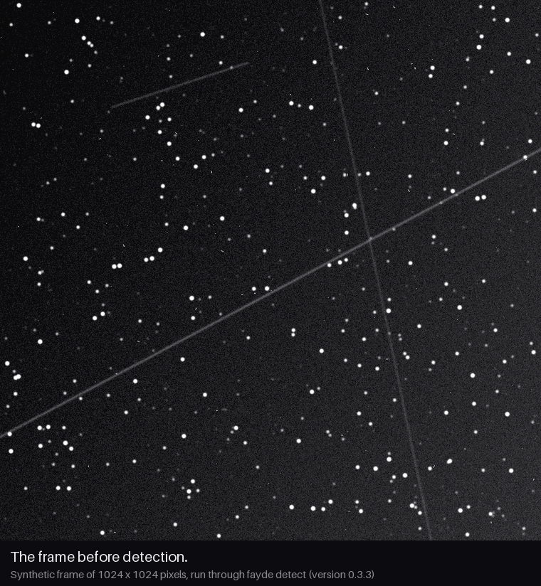
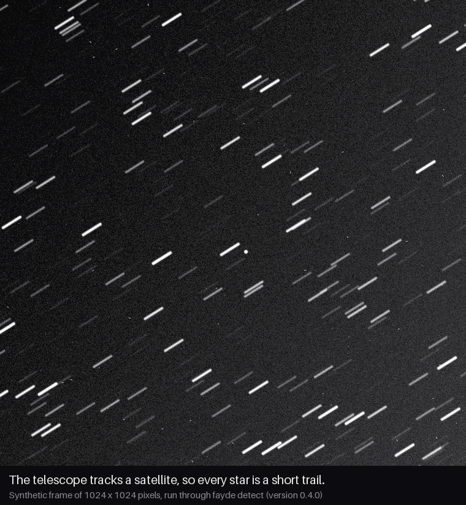

<div align="center">

# Fayde

**Verified astrometric plate solving for FITS images.**

[](https://github.com/shaneryall/Fayde/actions/workflows/ci.yml)
[](https://pypi.org/project/fayde/)
[](https://crates.io/crates/fayde-cli)
[](https://pypi.org/project/fayde/)
[](LICENSE)
[](https://doi.org/10.5281/zenodo.24379728)

[Install](docs/install.md) · [Catalog](docs/catalog.md) · [Command line](docs/usage.md) ·
[Python](docs/python.md) · [Changelog](CHANGELOG.md)

</div>

Give Fayde a star-field image. It finds the stars, matches them against the UCAC4 catalog, and
returns a world coordinate system (WCS) solution with its measured accuracy.

<!-- scripts/make_readme_figures.py makes both animations; its docstring gives the commands. -->

Both animations show `fayde detect` on a synthetic frame, with every mark drawn from its report.
On the left the stars are points, among cosmic-ray hits and three satellite streaks. On the right
every star trails.

<p align="center">
  
  
</p>

Fayde works as follows:

- Fayde detects the stars itself and sets aside hot pixels, cosmic-ray hits, and satellite
  streaks. The stars can be points, as from sidereal tracking, or trails of one length and
  direction, as when the telescope tracks a satellite. If you have your own detector, pass a
  source list instead.
- Fayde accepts a solution only after it tests the match against the catalog. The report gives
  the odds of the match against chance and the residuals of the fit.
- When the header gives the date of the image, Fayde moves the catalog positions to that date by
  their proper motions.
- With a pointing and a precise pixel scale from the header, Fayde needs only the catalog.
  Without them, it uses a pattern index that you build once.
- Fayde runs from the command line and from Python, prebuilt for Linux, macOS, and Windows. Its
  numerical results are the same on every platform, so you can repeat a solve anywhere.

## Quick start

> [!IMPORTANT]
> Fayde needs a local copy of the UCAC4 star catalog, about 9 GB of disk space.

For more information about virtual environment setup, prebuilt binaries without Python,
or installation with Cargo, see [Install Fayde](docs/install.md).

To install Fayde and solve a frame, follow these steps:

1. <a id="install-the-command-line-tool"></a><a id="install-the-python-package"></a>In a Python
   virtual environment, install Fayde:

   ```bash
   python -m pip install fayde
   ```

   This installs both the `fayde` command and the Python module.

2. <a id="get-the-ucac4-catalog"></a>Download the UCAC4 catalog as described in
   [Get the UCAC4 catalog](docs/catalog.md).

3. Solve a frame:

   ```bash
   fayde solve --image frame.fits --ucac4 UCAC4 -o frame.wcs
   ```

   Replace `frame.fits` with your image, `UCAC4` with your catalog directory, and `frame.wcs`
   with the file to write. Fayde prints a JSON report. When its `solved` field is `true`,
   `frame.wcs` holds the solution as FITS WCS header cards.

The image needs a header with the pointing and pixel scale. If the header lacks them, [give them
on the command line](docs/usage.md#specify-the-pointing-and-scale).

To locate streak candidates without a catalog, run
`fayde detect --image frame.fits > frame.detections.json`. The report gives pixel endpoints
and flags for each candidate. For more information, see
[Detect streaks without a catalog](docs/usage.md#detect-streaks-without-a-catalog).

## Use from Python

```python
import fayde

solver = fayde.Solver("/path/to/UCAC4")
report = solver.solve_image("frame.fits")
if report["solved"]:
    cards = report["wcs_cards"]
```

`solve_image` accepts a file path, a NumPy array, or an Astropy HDU. For more information, see
[Use Fayde from Python](docs/python.md).

## Documentation

| Page | What it covers |
|---|---|
| [Install Fayde](docs/install.md) | Prerequisites, binaries, checksums, Cargo, and the Python package |
| [Get the UCAC4 catalog](docs/catalog.md) | Downloading and laying out the catalog |
| [Use the command line](docs/usage.md) | Solving, detection, source lists, instrument profiles and their calibration, search limits, the report's fields, and checking a WCS |
| [Use Fayde from Python](docs/python.md) | The `Solver` class, `detect`, and how options map from the command line |
| [Build pattern indexes](docs/index-set.md) | Indexes for blind solving |
| [Source list format](docs/source-list.md) | The FITS table that `--sources` reads |
| [Versioning](docs/versioning.md) | What counts as a breaking change, and how options are deprecated |
| [Contribute to Fayde](CONTRIBUTING.md) | Reporting bugs, building from source, tests, and the rules for changes |

For the changes in each version, see the [changelog](CHANGELOG.md).

## Cite Fayde

If you use Fayde in work that leads to a publication, cite it as described in
[`CITATION.cff`](CITATION.cff), with the version that you used. A solved `.wcs` file records the
version, and the commit when it's known, in its comment cards.

## License

Fayde uses the GNU General Public License, version 3 or later. For license terms and
attribution, see [`LICENSE`](LICENSE) and [`NOTICE`](NOTICE). Versions 0.3.0 to 0.3.2 were
released under the Apache License 2.0 and stay under it. If you redistribute Fayde, include both
files. For the licenses of the bundled Rust crates, see
[`THIRD-PARTY-LICENSES.md`](THIRD-PARTY-LICENSES.md).
